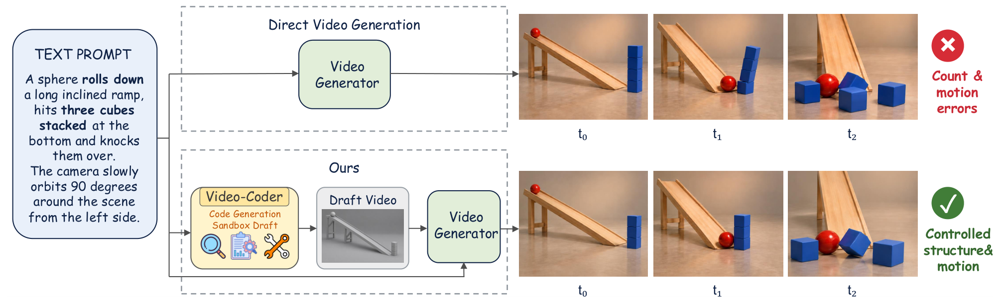
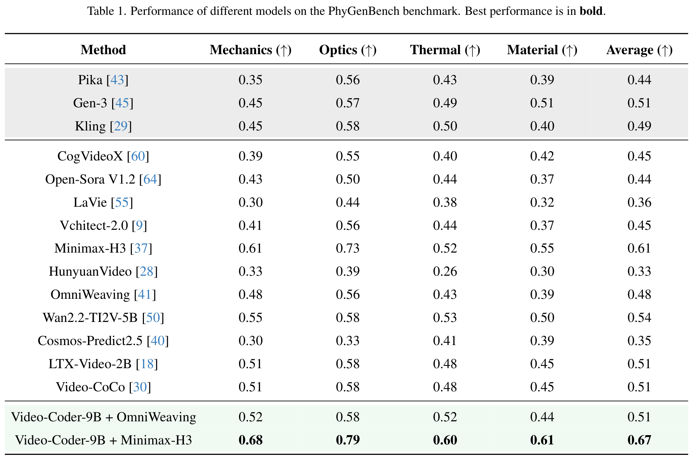
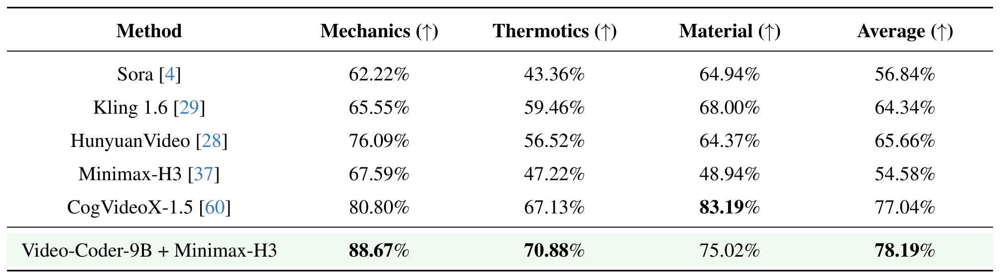
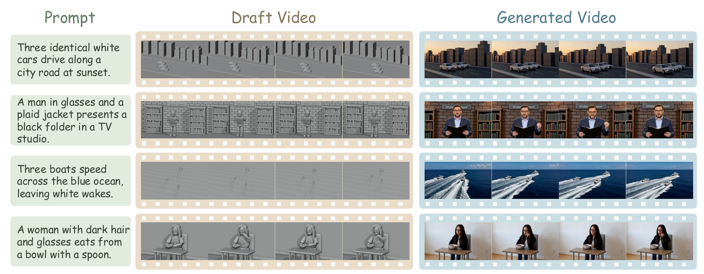

# Video-Coder: Reinforcing Agentic Coding for Video Generation

[[📖 Paper]()] [[🤗 Video-Coder-9B-model](https://huggingface.co/Video-Coder/Video-Coder-9B)] [🤗[Video-Coder-SFT-model](https://huggingface.co/Video-Coder/Video-Coder-SFT-9B)] [[🤗 Video-Coder-train-data](https://huggingface.co/datasets/Video-Coder/Train-Data)] 

## 👀 About Video-Coder

<div align="center">
  
</div>

We introduce **Video-Coder**, a code-driven video generation agent that autonomously writes and executes Blender Python programs to construct dynamic 3D scenes. The rendered **Draft Video** provides explicit structure and motion signals to downstream video generators.

We develop the **Video-Coder Harness**, a unified interactive environment integrating code execution, 3D scene rendering, and execution feedback. The same harness supports trajectory synthesis, agentic reinforcement learning, and inference.

Video-Coder is trained with supervised fine-tuning followed by **harness-native agentic reinforcement learning** with dual reward feedback. An execution reward encourages executable scene programs, while a video reward evaluates the generated results. An annealing strategy gradually reduces the execution reward during training, placing greater emphasis on video quality in later stages.

## 📍 Highlights

- **Executable 3D scene programs:** explicitly represent objects, spatial layout, motion, and camera behavior.
- **Iterative refinement:** write, execute, inspect, and revise programs through the Video-Coder Harness.
- **Two-stage training:** initialize with SFT, then improve generation through agentic RL with execution and video rewards.
- **Transfer across generators:** use the trained agent with MiniMax-H3 and OmniWeaving.
- **Physics-focused evaluation:** assess generation on PhyGenBench and VBench-2.0.


## 🏆 Performance

### PhyGenBench

**Video-Coder-9B + MiniMax-H3** achieves an average score of **0.67**, compared with **0.61** for MiniMax-H3 alone. It obtains scores of **0.68 / 0.79 / 0.60 / 0.61** on Mechanics, Optics, Thermal, and Material, respectively.

<div align="center">
  
</div>

### VBench-2.0

**Video-Coder-9B + MiniMax-H3** achieves an average score of **78.19%**, improving over MiniMax-H3 (**54.58%**) by **23.61 percentage points**. Its Mechanics score reaches **88.67%**, and its Thermotics score reaches **70.88%**.

<div align="center">
  
</div>

## 🎥 Qualitative Results

Video-Coder constructs draft videos that guide the generated videos through explicit object layout, motion, and camera control. The examples below show vehicles, human actions, and object interactions.

<div align="center">
  
</div>


## 🚀 Training

### Setup

```bash
# 1. Clone the repository
git clone https://github.com/CYWang735/Video-Coder.git
cd Video-Coder

# build SFT environment
conda create -n video-coder-sft python=3.12 -y
conda activate video-coder-sft
cd Video-Coder-SFT/ms-swift
pip install -e .
pip install flash-linear-attention      # fast Qwen3.5 linear attention (optional, much faster)
cd ../..

# build RL environment
conda create -n video-coder-rl python=3.12 -y
conda activate video-coder-rl
cd Video-Coder-RL/uni-agent
bash examples/video_coder/setup/install_env.sh
```

The RL stage runs the Video-Coder Harness in an [Apptainer](https://apptainer.org) sandbox. Build the Blender image and the [mini-swe-agent](https://github.com/SWE-agent/mini-swe-agent) tool directory once (needs internet; prefix `FAKEROOT=1` if your cluster builds images with `--fakeroot`). The script also fills their paths into the training and inference task configs.

```bash
cd Video-Coder-RL/uni-agent
bash examples/video_coder/setup/build_sandbox.sh
```

Download the training data from [🤗 Video-Coder/Train-Data](https://huggingface.co/datasets/Video-Coder/Train-Data) and unzip the ground-truth videos in place, so that the `gt_video` paths in `rl_data.json` resolve. Then put `sft_data.json` under `Video-Coder-SFT/ms-swift/data/`.

```bash
hf download Video-Coder/Train-Data --repo-type dataset --local-dir data/Train-Data
cd data/Train-Data/gt_video && unzip -q gt_video.zip && cd -
mkdir -p Video-Coder-SFT/ms-swift/data && cp data/Train-Data/sft_data.json Video-Coder-SFT/ms-swift/data/
```

### SFT Training

Our SFT simply follows [ms-swift](https://github.com/modelscope/ms-swift), using `sft_data.json` (multi-turn Video-Coder Harness trajectories).

```bash
cd Video-Coder-SFT/ms-swift
bash examples/train/Video-Coder/sft_qwen3_5_full.sh
```

The script fully fine-tunes [Qwen/Qwen3.5-9B](https://huggingface.co/Qwen/Qwen3.5-9B) with a 128k context (sequence parallel 4) on one node with 4 × H100 GPUs. The SFT checkpoint initializes the RL stage.

### RL Training

First, convert `rl_data.json` into the training parquet.

```bash
cd Video-Coder-RL/uni-agent
python -m uni_agent.tasks.video_coder.preprocess --tasks ../../data/Train-Data/rl_data.json \
    --out $PWD/data/video_coder_train.parquet --require-gt --gt-request-sidecar
```

Launch the video generator for the video reward, here we use [MiniMax-H3](https://huggingface.co/MiniMaxAI/MiniMax-H3) (Ref2VA) served with SGLang. Each server uses 4 GPUs; more servers make each step faster (we used 4).

```bash
cd Minimax-H3-server
bash setup_env.sh && bash download_model.sh     # once
HOST=0.0.0.0 PORT=30011 bash serve.sh
```

The draft video of each accepted rollout is turned into a video by MiniMax-H3, and a VLM judge (`qwen3.8-omni-flash` on DashScope) scores it against the ground-truth video. You may also change to other video generators or judges by revising the `video_reward` section of the task config and [`video_reward.py`](./Video-Coder-RL/uni-agent/uni_agent/tasks/video_coder/video_reward.py).

Then, in the task config [`task_config_video_coder_video_reward_apptainer.yaml`](./Video-Coder-RL/uni-agent/examples/quickstart/training/task_config_video_coder_video_reward_apptainer.yaml), set the launched server URLs in `video_reward.ref2va.base_urls` and a `video_reward.ref2va.shared_dir` visible to the trainer and the servers at the same path (the sandbox paths were filled in by `build_sandbox.sh`). Export your `DASHSCOPE_API_KEY` on every node before starting Ray. Training logs to [wandb](https://wandb.ai) by default: run `wandb login` first, or set `TRAINER_LOGGER="['console']"`. With several nodes, the data, `CKPTS_DIR` and `shared_dir` must be on storage that every node sees.

Finally, start the RL training based on the SFT model. On Slurm clusters, `unset ROCR_VISIBLE_DEVICES` before `ray start` (Ray and vLLM refuse to start with it), and if you use an HTTP proxy, add `127.0.0.1,localhost` and your node names to `no_proxy`.

```bash
cd Video-Coder-RL/uni-agent
ray start --head            # on the other nodes: ray start --address=<head>:6379
MODEL_PATH=/path/to/sft_checkpoint CKPTS_DIR=/path/to/ckpts \
TRAIN_FILE=$PWD/data/video_coder_train.parquet TEST_FILE=$PWD/data/video_coder_train.parquet \
NNODES=2 NGPUS_PER_NODE=4 GATEWAY_COUNT=4 CONCURRENCY=64 \
TRAIN_PROMPT_BSZ=8 N_RESP_PER_PROMPT=8 PPO_MINI_BATCH_SIZE=8 NUM_WARMUP_BATCHES=0 \
TOTAL_EPOCHS=3 MAX_RESPONSE_LENGTH=114688 SAVE_FREQ=5 \
bash examples/video_coder/train_video_coder_rl.sh
```

We trained RL on 8 × H100 GPUs (2 nodes), plus 4 GPUs per MiniMax-H3 server.

## 🔮 Inference

Prepare your own prompts in the same format as the training data: a JSON list of `{"id": ..., "prompt": ...}` (`gt_video` is not needed).

First, generate the **Draft Video** for each prompt with the trained Video-Coder in the Video-Coder Harness, using the RL environment and sandbox from [Training](#-training).

```bash
cd Video-Coder-RL/uni-agent
ray start --head
MODEL_PATH=/path/to/Video-Coder-9B DATA=/path/to/your_data.json OUT=/path/to/output \
bash examples/video_coder/inference/run_inference.sh
```

Each draft video is written to `/path/to/output/drafts/<id>/render.mp4`, together with the Blender script (`main.py`) that rendered it. A prompt whose script fails is retried (up to 3 attempts), and rerunning the command resumes. The script also writes `/path/to/output/h3_manifest.jsonl` for the next step.

Then, launch [MiniMax-H3](https://huggingface.co/MiniMaxAI/MiniMax-H3) and turn the draft videos into the **Final Video**.

```bash
cd Minimax-H3-server
bash setup_env.sh && bash download_model.sh     # once
bash run_batch.sh /path/to/output/h3_manifest.jsonl /path/to/output/final
```

The final videos are written to `/path/to/output/final/<id>.mp4`.

## Acknowledgements

We thank the open-source projects that support this implementation, including [ms-swift](https://github.com/modelscope/ms-swift), [verl](https://github.com/volcengine/verl), [mini-swe-agent](https://github.com/SWE-agent/mini-swe-agent), and [SGLang](https://github.com/sgl-project/sglang).
